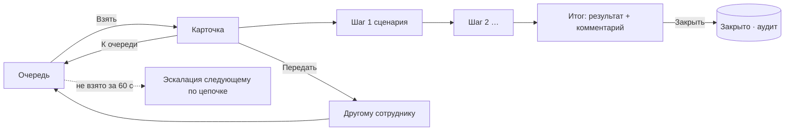

# Безопасное образование — прототип v0.2

Документ описывает переработку прототипа `prorotypes/index.html`, которую мы сделали по итогам ревью:

- замечания из [Корректировка дашборда SafeEducation_Specification.md](Корректировка%20дашборда%20SafeEducation_Specification.md); вопросы из этого файла пока не разбираем;
- интерфейс и архитектурные решения взяты из Incident Manager (IM) и адаптированы под образование;
- в интерфейс добавлен выбор языка и английский перевод;
- прототип переведён на новую версию ONE PSIM Prototype Kit;
- всё, что настраивается на сервере, собрано в одном разделе «Конфигурация», чтобы позже вынести его в отдельный конфигуратор.

Базовое ТЗ остаётся прежним: [SafeEducation_Specification.md](SafeEducation_Specification.md). Номера требований (SKD-…) в документе — оттуда.

---

## 1. Как закрыты замечания

### 1.1 Профиль «Школа», общее

| № | Замечание | Что сделано | Где посмотреть |
|---|---|---|---|
| 1 | Убрать «Пост охраны» из списка «Объект» | Раздел «Пост охраны» есть в меню только у роли «Пост охраны». У директора и зама по безопасности его нет. | Меню слева, смена роли — кнопка с ползунками в шапке |
| 2 | Убрать свободное место на главной, поднять «Сводку посещаемости» | На главной теперь две независимые колонки, каждая заполняется сверху. Слева — камеры и последние события. Справа первой идёт «Сводка посещаемости», за ней «Состояние систем» и «Заполненность зон». Пустого места под короткой колонкой больше нет. | Главная |
| 3 | Откуда берутся группы камер | **Вопрос — пропущен** (см. раздел 2) | — |
| 4 | % на шкале «Присутствие» в сводке | Справа от шкалы выводится процент, например `92 %`. Цвет шкалы зависит от порога. | Посещаемость → Сводка |
| 5 | Сортировка в сводке | Сортировать можно по любому столбцу. Первое нажатие сортирует по возрастанию, второе — по убыванию. Направление показывает стрелка и `aria-sort`. | Посещаемость → Сводка |
| 6 | Сортировка в журнале | Сортировка есть по ФИО, группе, статусу, времени входа и выхода, причине. Она работает вместе с фильтрами и постраничным выводом по 50 строк. | Посещаемость → Журнал |
| 7 | В перекличке статус наезжает на имя | Строка ребёнка — сетка из трёх столбцов: аватар, колонка «имя над статусом», кнопки. Длинный статус («Отсутствует · семейные обстоятельства») переносится внутри своей колонки. | Перекличка |
| 8 | Нет инструмента добавления людей в «Держатели пропусков» | Добавлена кнопка «Добавить человека» и диалог с переключателем «Ученик / Сотрудник». Для ученика заполняются ФИО, группа, номер карты, фото и законные представители, для сотрудника — ФИО, должность и карта. Каждое добавление записывается в аудит. | Люди и пропуска → Держатели |
| 9 | Сортировка держателей | Сортировка по ФИО, категории, группе или должности, номеру пропуска и состоянию. | там же |
| 10 | Нет инструмента добавления посетителей | Кнопка «Добавить посетителя» вынесена в заголовок вкладки. Посетитель сверяется со стоп-листом: при совпадении его не пускают и показывают причину. | Люди и пропуска → Посетители |
| 11 | Сортировка посетителей | Сортировка по ФИО, типу, к кому пришёл, времени входа и выхода. | там же |
| 12 | Новый раздел «Обход» (только для «Поста охраны») | Охранник выбирает маршрут и проходит чек-лист. У каждой точки две кнопки: «Проверено» и «Не проверено». Для «Не проверено» нужно замечание. «Завершить обход» становится доступной, когда отмечены все точки. Обход попадает в «Журналы → Журнал обхода». Пока обход идёт, в меню виден прогресс, например `3/7`. | Роль «Пост охраны» → Обход |
| 12′ | Неисправность после заявки в «Все неисправности» | **Вопрос — пропущен** (см. раздел 2) | — |
| 13 | Сортировка в аудите | Сортировка по времени, пользователю, действию и объекту. Цепочка хешей проверяется так же, как раньше. | Аудит |
| 14 | Добавление и редактирование режимов | В «Конфигурации → Режимы объекта» можно добавить режим и изменить его: название, цвет в шапке, расписание (дни и часы), действия при включении (макросы «Интеллект X»), описание. Новый режим сразу появляется в меню режимов в шапке. Системные режимы («Учебная тревога», «Эвакуация», «ЧС») удалить нельзя, у них меняются только действия и описание. | Конфигурация → Режимы объекта |

Напоминание «полностью проверить объект „Журналы“» — ваша заметка, мы его не трогали.

### 1.2 По ролям и профилям

| Профиль · роль | Замечание | Что сделано |
|---|---|---|
| Школа · Директор | Убрать «Пост охраны» и «Перекличку» | Убраны: `deny: post, rounds, rollcall` |
| Школа · Директор | Плашка для создания чек-листов обходов | «Конфигурация → Обходы»: маршруты и точки. Точку можно добавить, переименовать, переставить выше или ниже, удалить. Изменения сразу попадают в «Обход» у поста. |
| Школа · Пост охраны | Новый объект «Обход» | Раздел «Обход» (см. п. 12) |
| Детсад, колледж · Директор | Убрать «Пост охраны» и «Перекличку» | Так же, как в школе: права задаются ролью, а не профилем |
| Детсад, колледж · Директор | При создании ребёнка прикрепить родителя с фотографией | В диалоге «Добавить человека» есть блок «Законные представители». Для каждого представителя вводятся ФИО, кем приходится, телефон и фото, представителей может быть несколько. В детском саду есть ещё флажок «Может забирать ребёнка»: такие представители попадают в список доверенных для «Приёма и выдачи». Фото представителя видит воспитатель при выдаче. Биометрия не используется, фото нужно только чтобы сверить лицо глазами. |
| Детсад, колледж · Зам по безопасности | Убрать «Пост охраны» | Убран: `deny: post, rounds, audit, config` |

### 1.3 Итоговая матрица доступа

| Раздел | Директор | Зам по безопасности | Пост охраны | Классный руководитель / воспитатель |
|---|:-:|:-:|:-:|:-:|
| Главная | ✓ | ✓ | — | — |
| Пост охраны | — | — | ✓ (стартовый) | — |
| Обход | — | — | ✓ | — |
| Видеонаблюдение | ✓ | ✓ | ✓ (архив ≤ 24 ч) | — |
| Посещаемость | ✓ | ✓ | — | ✓ (только своя группа) |
| Приём и выдача детей (детсад) | ✓ | ✓ | — | ✓ |
| События | ✓ | ✓ | ✓ | — |
| Перекличка | — | ✓ | — | ✓ |
| Люди и пропуска | ✓ | ✓ | ✓ (без блокировки) | — |
| Журналы | ✓ | ✓ | ✓ | — |
| Отчёты, Обслуживание | ✓ | ✓ | — | — |
| Конфигурация | ✓ | — | — | — |
| Аудит | ✓ | — | — | — |

В «Конфигурации → Роли и доступ» матрица показана только для чтения. Сами права назначаются в «Интеллект X».

---

## 2. Отложенные вопросы

| № | Вопрос | Как в прототипе сейчас | Что нужно решить |
|---|---|---|---|
| 3 | Откуда берутся группы камер в «Видеонаблюдении»? | Дерево «Здание → Зона» строится по модели объекта (SKD-OBJ-01/02): у камеры есть здание и зона. Так же устроено дерево групп в IM. Отдельного инструмента привязки нет. | Брать ли группы из «Интеллект X» (группы и слои карты) или вести их в решении. Во втором случае в «Конфигурации» понадобится вкладка «Группы камер» с привязкой. |
| 12′ | Как неисправность связана с заявкой в «Все неисправности» | Без изменений: заявка создаётся из неисправности, а неисправность пропадает из списка, когда устройство снова в норме. | Нужно пояснение, что именно ожидается. |

---

## 3. Что взято из Incident Manager

IM — почти законченное вертикальное решение на тех же продуктах. Взяли то, что подходит и школе, и детсаду, и колледжу.

### 3.1 Каркас экрана

```
┌──────────────┬──────────────────────────────────────────────────────────────────────┐
│ Интеллект X  │ Заголовок / учреждение   [● Режим ▾] 🌐 [Русский ▾] [⚙] [☾] [Пользователь ▾] 10:40 │
│ Безопасное   ├──────────────────────────────────────────────────────────────────────┤
│ образование  │ ⚠ Данные устарели · связь с сервером потеряна   (msgbar-band, по событию)│
│              ├──────────────────────────────────────────────────────────────────────┤
│ ОБЪЕКТ       │                                                                      │
│  Главная     │                         рабочая область                              │
│  …           │                                                                      │
│ УЧЁТ И       │                                                                      │
│ РЕГЛАМЕНТЫ   │                                                                      │
│ АДМИНИСТРИ-  │                                                                      │
│ РОВАНИЕ      ├──────────────────────────────────────────────────────────────────────┤
│              │ ● Режим · В здании · Новых событий · Неисправностей · ● Связь   демо-время │
└──────────────┴──────────────────────────────────────────────────────────────────────┘
```

- Меню разбито на три раздела, как в IM: «Объект», «Учёт и регламенты», «Администрирование». У пунктов есть счётчики: новые события, просроченные заявки, прогресс обхода, идущая перекличка.
- В шапке, как в IM, есть язык, тема, меню пользователя и часы. Своё здесь — меню режима объекта, окрашенное в цвет текущего режима.
- Строка состояния внизу взята из IM: режим, сколько людей в здании, новые события, неисправности, связь с сервером.
- Уведомления показываются как msgbar-тосты кита: не больше двух на экране, остальные собираются в «ещё N».
- На ширине до 1024 px меню выезжает поверх контента. Вся вёрстка проверена на 360 px.

### 3.2 Рабочее место «События»

Раньше здесь была таблица. Теперь — рабочее место IM из трёх панелей.

```
┌ Группы ─────────┬ Очередь событий  [Открытые|Мои|Закрытые|Все] ─┬ Видео и план ───────┐
│ ▣ Все события 4 │ 🔍 зона, камера…  (Тревоги)(Аналитика)(…)       │ архив камеры        │
│ ▤ Корпус А    ❹ │ ▌⚠ Драка  Новое             [Взять]            │ ─────────────────── │
│   ◎ Коридоры 1  │ ▌  10:39 · Корпус А · Коридор  [Посмотреть]    │ план этажа с точкой │
│   ◎ Вход/КПП 2  │ ▌  ⏱ Реакция 00:42                             │ события             │
│ ▤ Корпус Б      │ ▌⚠ Проход «за спиной» …                         │                     │
│ ▤ Объект целиком│                                                 │                     │
└─────────────────┴─────────────────────────────────────────────────┴─────────────────────┘
```

- **Группы** — дерево «здание → зона» со счётчиками открытых событий. Если среди открытых есть критичное, счётчик красный.
- **Очередь** — плашки событий. Слева полоса приоритета. В плашке: значок типа, статус, место, описание и таймер реакции (SLA), который краснеет после нормы. Справа кнопки «Взять» и «Посмотреть». Под очередью — фильтр по статусу, чипы категорий и поиск.
- **Карточка события** открывается вместо очереди после «Взять»:



  Над шагами — «хлебные крошки». Тип шага бывает трёх видов: «сообщение», «подтвердить (Выполнено)» и «выбор варианта». Дальше по сценарию не пройти, пока не отмечен текущий шаг. Закрыть событие без результата нельзя (SKD-EVT-04). Внизу кнопки, как в IM: «К очереди», «Передать» (оранжевая), «Закрыть без обработки», «Назад», «Далее». Журнал действий по событию ведётся в самой карточке.
- **Видео и план** — архив камеры события и план этажа с отметкой. Панель обновляется при выборе плашки.
- Сценарии адаптированы под образование: драка, проход «за спиной», ушёл раньше расписания, заполненность зоны, ответ родителя «не знаю», КТС, неисправности.

### 3.3 Видеонаблюдение

Дерево групп устроено так же, как в IM: «Все камеры → здание → зона». Есть поиск по названию и раскладки 1/4/9. Камера, которую перехватил СРВИ, показывается как «недоступна», и заявка на неё не создаётся.

### 3.4 Один диалог для форм

Как в IM, все формы открываются в одном `dialog`: режим, причина, блокировка, человек, посетитель, представитель, событие, точка обхода. Боковая панель (sheet) нужна только для просмотра карточек ребёнка и списков.

### 3.5 Языки

Подход тот же, что в IM:

- Ключ перевода — сама русская строка: `t('Отмечено {a} из {b}', {a, b})`. Каталог `I18N_EN` лежит в `src/i18n-en.js`, сейчас в нём 959 строк. Для множественного числа есть `pl()`, по правилам русского и английского.
- Имена, которые вводят люди, не переводятся: ФИО, классы и группы, названия камер и зон, учреждения.
- Аудит хранит ключ действия и его параметры, поэтому журнал аудита переводится вместе с интерфейсом.
- Язык выбирается в шапке, на телефоне — в меню пользователя. Выбор хранится в `localStorage` (`se-lang`).
- `tools/check_i18n.py` разбирает исходники и обходит все экраны на английском. Если находит строку без перевода, проверка падает.

---

## 4. Раздел «Конфигурация»: всё, что хранится на сервере

Раньше серверные настройки были разбросаны по разделам: SLA лежал в «Обслуживании», режимы — в «Настройках». Теперь всё, что хранится на сервере «Интеллект X» и действует на всех рабочих местах, собрано в одном разделе. Вверху раздела — плашка: «Позже раздел переедет в отдельный конфигуратор».

| Вкладка | Что настраивается | Требования |
|---|---|---|
| Профиль учреждения | Школа / детский сад / колледж: словарь, уведомления родителям, «Приём и выдача» | SKD-UI-04 |
| Правила дня | Окна прихода, опоздания и ухода, время сверки по каждой группе, вторая смена | SKD-PRS-03 |
| Режимы объекта | Список режимов, добавление и изменение, расписание, действия при включении, цвет | SKD-MOD-01, замечание 14 |
| Обходы | Маршруты и чек-листы точек | замечание 12, директор п. 3 |
| Уведомления в MAX | Что отправлять законным представителям и когда | SKD-NTF |
| Зоны и вместимость | Порог заполненности зон | SKD-OBJ-04, SKD-PRS-09 |
| SLA обслуживания | Нормы реакции обслуживающих организаций (перенесено из «Обслуживания») | SKD-SYS-03 |
| Роли и доступ | Матрица доступа, только для чтения | раздел 9 |

```mermaid
flowchart LR
  subgraph Сервер «Интеллект X»
    CFG[(Конфигурация объекта<br/>профиль · правила · режимы · обходы<br/>уведомления · зоны · SLA)]
  end
  CFG --> W1[Рабочее место директора]
  CFG --> W2[Пост охраны: Обход, режимы]
  CFG --> W3[Телефон учителя: перекличка]
  CFG --> N[Уведомления в MAX]
  X[Будущий отдельный конфигуратор] -. заменит вкладку .-> CFG
```

Раздел видит только директор. Сохранение режимов, маршрутов обхода и настроек вкладок пишется в аудит.

---

## 5. Новая дизайн-система

Прототип перешёл со старого пакета (`bundle.css`, `bundle.js`, `tokens.json`) на новый ONE PSIM Prototype Kit:

- `vendor/one-psim/kit.css` (Tailwind 4) — токены `--color-*` и `--one-*` и компоненты: `btn`, `field`, `seg` (с ползунком), `chip`, `badge`, `menu`, `popover`, `dialog`, `table`, `tabs`, `nav-item`, `msgbar`/`msgbar-band`, `toasts`/`toast-more`, `tip`, `status-dot`, `filterrow`, `empty`, `skeleton`, `kpi-value`, компактные `btn-compact`/`field-compact`;
- `vendor/one-psim/kit.js` — поведение через атрибуты: `data-kit-theme`, `data-kit-menu`, `data-kit-keep-open`, `data-kit-close`, `data-tip`, сегменты; без `init()`;
- шрифт Inter встроен в страницу, иконки — Octicons, одним семейством.

Слой страницы `src/app.css` использует только токены кита. Своё в нём — каркас, плашки очереди, сетка рабочего места, перекличка, обход, конфигурация.

---

## 6. Структура и проверки

```
prorotypes/
  index.html               собранный прототип (≈ 940 КБ, без сети)
  README.md
  src/body.html  app.css  i18n-en.js  selftest.js
  src/js/00-icons … 99-boot  модули: ядро, данные, каркас, главная, события, посещаемость,
                             люди/обход/видео, экраны, конфигурация, действия
  vendor/one-psim/ kit.css kit.js InterVariable.woff2
tools/
  build_prototype.py  run_selftest.py  check_ui.py  check_i18n.py
```

| Проверка | Результат |
|---|---|
| `run_selftest.py`: шаги по замечаниям и требованиям ТЗ | 36 из 36 |
| `check_ui.py`: 14 экранов × 2 темы × 1440/360 px | 0 ошибок. Известное отклонение задано самим китом: `--color-fg-subtle` 4,45:1 |
| `check_i18n.py` | 0 строк без перевода |

Самопроверку можно открыть и в браузере: `index.html?selftest`.
